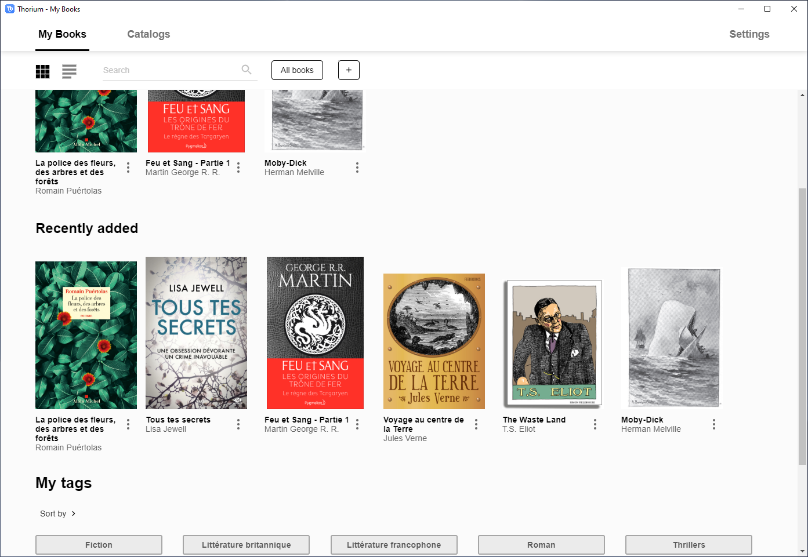
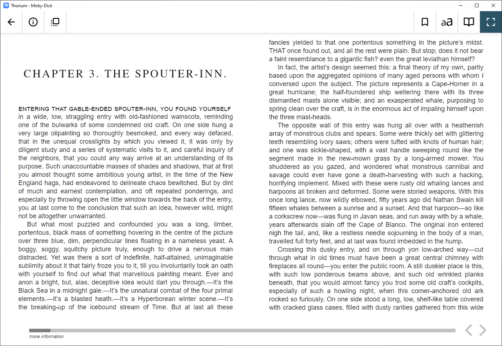

# Thorium Reader

Thorium Reader is an easy to use EPUB reading application for Windows 10/10S, MacOS and Linux. After importing e-books from a directory or OPDS feed, you'll be able to read on any screen size, customize layout settings, navigate via the table of contents or page list, set bookmarks ... A great care is taken to ensure the accessibility of the application for visual impaired people using NVDA, JAWS or Narrator.

Free application. No ads. No private data flowing anywhere.

This project is in constant evolution, corrections and new features will be added soon and your support is welcome for that. The application is based on the open-source Readium Desktop toolkit.

More information can be found in the [Landing page](https://www.thoriumreader.com/).

It is currently localized in following 30 languages:

* (en) English
* (fr) Français (French)
* (fi) Suomi (Finnish)
* (de) Deutsch (German)
* (es) Español (Spanish)
* (nl) Nederlands (Dutch)
* (nb-NO) Bokmål (Norwegian)
* (ja) 日本語 (Japanese)
* (ka) ქართული (Georgian)
* (lt) Lietuvių (Lithuanian)
* (pt-BR) Português Brasileiro (Portuguese - Brazil)
* (pt-PT) Português (Portuguese - Portugal)
* (zh-CN) 简体中文 - 中国 (Simplified Chinese - China)
* (zh-TW) 繁體中文 - 台灣 (Traditional Chinese - Taiwan)
* (it) Italiano (Italian)
* (ru) Русский (Russian)
* (ko) 한국어 (Korean)
* (sv) Svenska (Swedish)
* (ca) Catalan
* (gl) Galician
* (eu) Euskadi (Basque)
* (el) ελληνικός (Greek)
* (bg) български (Bulgarian)
* (hr) Hrvatski (Croatian)
* (da) Dansk (Danish)
* (sl) Slovenščina (Slovene)
* (cs) čeština (Czech)
* (ar) عَرَبِيّ (Arabic)
* (hi) हिन्दी (Hindī)
* (sa) संस्कृतम् (Saṃskṛtam)

Since february 2025 we use Weblate project Thorium as the main tool for localisation. The following bar chart shows the translation status that is available from weblate.

<a href="https://hosted.weblate.org/engage/thorium-reader/">

</a>





## Human Developers And Coding Agents

Please read the [AGENTS.md](./AGENTS.md) documentation.

## LCP support in Thorium Reader

Thorium Reader supports LCP-protected publications via an additional software component which is not available in this open-source codebase. When Thorium Reader is compiled from the open-source code without the additional production-grade library, the application can only load publications protected with the LCP "Basic Encryption Profile". For example, licenses generated by the open-source LCP server written in Go, without the patch that enables production-grade LCP Encryption Profiles.

In order to create a production-grade LCP-compliant variant / derivation of Thorium Reader (known as a "fork"), additional confidential software components and processes must be integrated in the custom application's build / release workflow. This represents a non-trivial amount of time and effort, as well as close collaboration between the fork's development team and EDRLab's technical staff. To cover operational costs, EDRLab charges a maintenance fee. Feel free to contact EDRlab to discuss your requirements.

## Command line

```
thorium <cmd> [args]

Commands:
  thorium opds <title> <url>  import opds feed
  thorium import <path>       import epub or lpcl file
  thorium read <title>        searches already-imported publications with the
                              provided TITLE, and opens the reader with the
                              first match
  thorium [path]              import and read an epub or lcpl file     [default]
  thorium completion          generate bash completion script

Positionals:
  path  path of your publication, it can be an absolute, relative path  [string]

Options:
  --version  Show version number                                       [boolean]
  --help     Show help                                                 [boolean]
```

## Support for HTTP proxy

The `HTTPS_PROXY`, `HTTP_PROXY`, and `NO_PROXY` environment variables are honored. Use them if you need to pass HTTP or HTTPS requests through a proxy server. On Windows and MacOS, the operating system provides additional discovery methods (e.g. the Windows registry) which the application uses in addition to the env vars.
