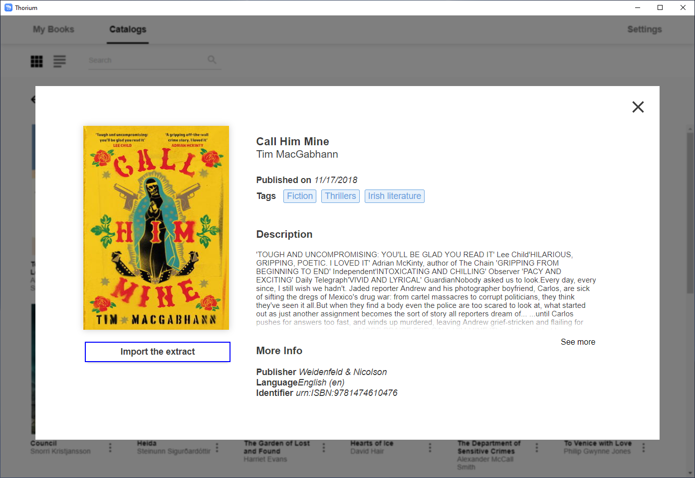

# Thorium Reader

Thorium Reader is an easy to use EPUB reading application for Windows 10/10S, MacOS and Linux. After importing e-books from a directory or OPDS feed, you'll be able to read on any screen size, customize layout settings, navigate via the table of contents or page list, set bookmarks ... A great care is taken to ensure the accessibility of the application for visual impaired people using NVDA, JAWS or Narrator.

Free application. No ads. See [Telemetry and privacy](#telemetry-and-privacy) for details about usage measurements and your settings.

This project is in constant evolution, corrections and new features will be added soon and your support is welcome for that. The application is based on the open-source Readium Desktop toolkit.

More information can be found in the [Landing page](https://www.thoriumreader.com/).

It is currently localized in following 30 languages:

* (en) English
* (fr) Français (French)
* (fi) Suomi (Finnish)
* (de) Deutsch (German)
* (es) Español (Spanish)
* (nl) Nederlands (Dutch)
* (nb-NO) Bokmål (Norwegian)
* (ja) 日本語 (Japanese)
* (ka) ქართული (Georgian)
* (lt) Lietuvių (Lithuanian)
* (pt-BR) Português Brasileiro (Portuguese - Brazil)
* (pt-PT) Português (Portuguese - Portugal)
* (zh-CN) 简体中文 - 中国 (Simplified Chinese - China)
* (zh-TW) 繁體中文 - 台灣 (Traditional Chinese - Taiwan)
* (it) Italiano (Italian)
* (ru) Русский (Russian)
* (ko) 한국어 (Korean)
* (sv) Svenska (Swedish)
* (ca) Catalan
* (gl) Galician
* (eu) Euskadi (Basque)
* (el) ελληνικός (Greek)
* (bg) български (Bulgarian)
* (hr) Hrvatski (Croatian)
* (da) Dansk (Danish)
* (sl) Slovenščina (Slovene)
* (cs) čeština (Czech)
* (ar) عَرَبِيّ (Arabic)
* (hi) हिन्दी (Hindī)
* (sa) संस्कृतम् (Saṃskṛtam)

Since february 2025 we use Weblate project Thorium as the main tool for localisation. The following bar chart shows the translation status that is available from weblate.

<a href="https://hosted.weblate.org/engage/thorium-reader/">

</a>





## Human Developers And Coding Agents

Please read the [AGENTS.md](./AGENTS.md) documentation.

## Telemetry and privacy

Thorium can send measurements that help EDRLab understand application adoption, operating system support, publication formats, and feature usage, to guide development. What is sent depends on the build configuration. There are two separate telemetry systems.

### Startup statistics

When configured in a packaged build, Thorium sends a startup report to EDRLab's telemetry service (`https://telemetry.edrlab.org/`, or `https://telemetry-staging.edrlab.org/` for test builds). It contains:

* Operating system version and application language.
* Report timestamp, current and previously recorded Thorium versions, and whether those versions differ (including a first launch).
* A report type, currently `poll`.

These reports contain no installation identifier or publication information. Unsent reports are saved locally in `telemetry/queue.json` inside Thorium's application data folder. On each startup, Thorium keeps up to ten previous reports and adds the current report. The queue is cleared after a successful delivery; failed deliveries are retried on a later startup.

### Usage analytics

Builds configured for Google Analytics 4 send usage events through Google's Measurement Protocol, by default to `https://www.google-analytics.com/mp/collect`. This integration is disabled by default when building from source; distribution builds can enable it. The events contain:

* A randomly generated installation identifier saved across launches, a session identifier, and event timestamps. The installation identifier allows events from the same installation to be associated over time; these measurements should therefore not be described as fully anonymous.
* Thorium version, operating system name and version, application and system languages, primary screen resolution, and Electron version. The device model is reported as the generic value `Desktop`.
* Application launches, first launch, version changes, generic library screen visits, customization profile activation, and time spent with the library or reader window in focus.
* Publication imports, reading or listening, saving, deletion, tagging, marking as finished, and annotation imports or exports. Publication details are limited to format, media type, LCP license type (expiring or permanent), and LCP provider when present.
* Catalog actions and how a catalog was added (manually, via a link, PNB, or the registry); reader actions such as searching, bookmarking, annotating, navigation, and preference changes; application setting names and their selected values, including the screen reader setting.
* LCP dialog and help usage, and whether a passphrase was valid, invalid, or automatically discovered.

The usage events do not include book titles, authors, book text, file paths, catalog URLs, search terms, tag text, annotation or bookmark contents, passwords, or LCP passphrases. Library screen visits use generic screen names and synthetic addresses, rather than actual catalog or profile addresses. As with any network request, the receiving service can see the connection's IP address.

The installation identifier is stored locally in Thorium's saved application state. Pending events and their associated identifiers and device information are stored in `analytics/measurement-protocol-queue.json` (or `analytics/measurement-protocol-queue.sqlite`, depending on the build) inside the application data folder. Thorium retries delivery in batches and removes successfully delivered events. The queue holds at most 1,000 events; events older than 72 hours are discarded when the queue is processed. These local limits do not specify how long a receiving service retains data already sent; server-side retention and access policies are not defined in this repository.

### Telemetry setting

In **Settings → Advanced → Telemetry**, enable **Disable telemetry measurements** to stop recording new Google Analytics usage events. This preference is saved across launches and is off by default.

In the current implementation, this setting does not clear or stop delivery of Google Analytics events already queued, and it does not disable the separate EDRLab startup reports. It also does not delete measurements already received by either service.

For build configuration details, see [Telemetry, analytics](./docs/telemetry.md).

## LCP support in Thorium Reader

Thorium Reader supports LCP-protected publications via an additional software component which is not available in this open-source codebase. When Thorium Reader is compiled from the open-source code without the additional production-grade library, the application can only load publications protected with the LCP "Basic Encryption Profile". For example, licenses generated by the open-source LCP server written in Go, without the patch that enables production-grade LCP Encryption Profiles.

In order to create a production-grade LCP-compliant variant / derivation of Thorium Reader (known as a "fork"), additional confidential software components and processes must be integrated in the custom application's build / release workflow. This represents a non-trivial amount of time and effort, as well as close collaboration between the fork's development team and EDRLab's technical staff. To cover operational costs, EDRLab charges a maintenance fee. Feel free to contact EDRlab to discuss your requirements.

## Command line

```
thorium <cmd> [args]

Commands:
  thorium opds <title> <url>  import opds feed
  thorium import <path>       import epub or lpcl file
  thorium read <title>        searches already-imported publications with the
                              provided TITLE, and opens the reader with the
                              first match
  thorium [path]              import and read an epub or lcpl file     [default]
  thorium completion          generate bash completion script

Positionals:
  path  path of your publication, it can be an absolute, relative path  [string]

Options:
  --version  Show version number                                       [boolean]
  --help     Show help                                                 [boolean]
```

## Support for HTTP proxy

The `HTTPS_PROXY`, `HTTP_PROXY`, and `NO_PROXY` environment variables are honored. Use them if you need to pass HTTP or HTTPS requests through a proxy server. On Windows and MacOS, the operating system provides additional discovery methods (e.g. the Windows registry) which the application uses in addition to the env vars.
